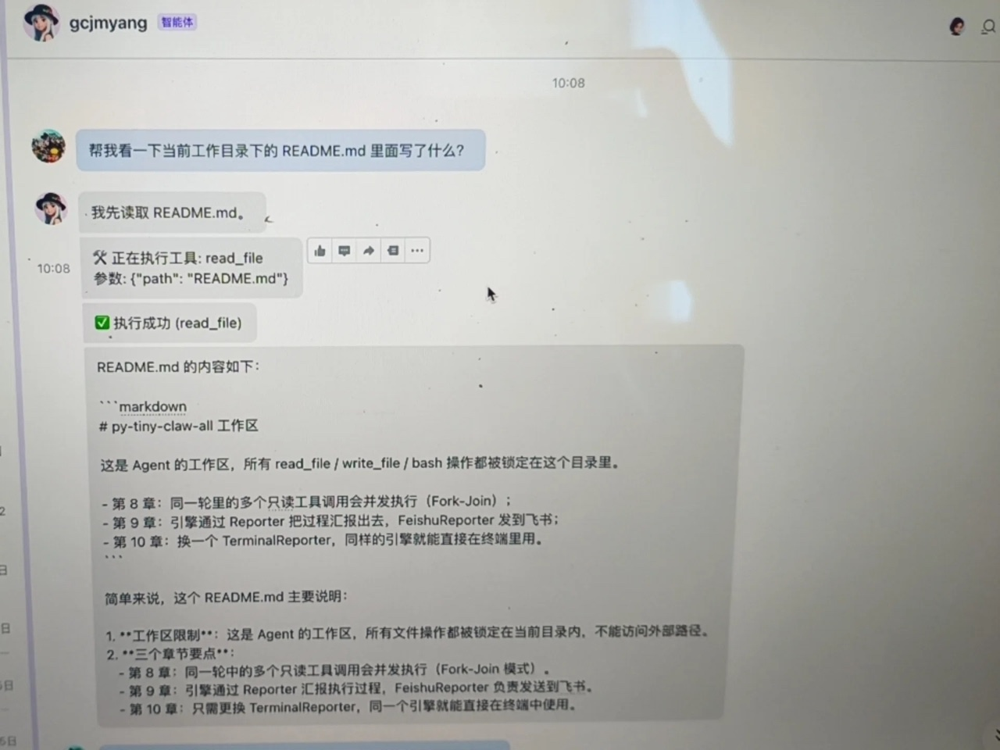
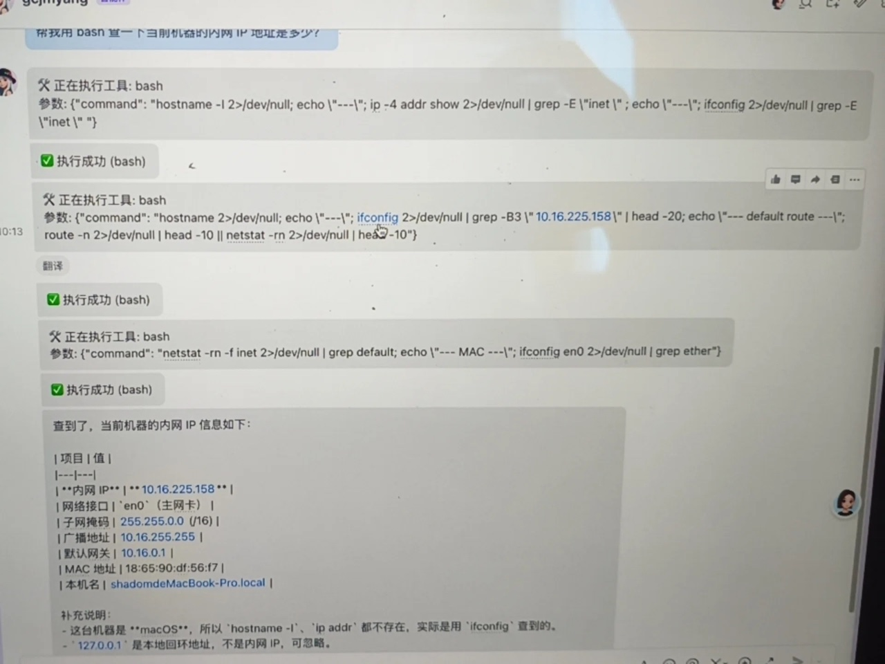

# 实验报告：飞书集成 —— Reporter 汇报接口与飞书机器人

> 课程：AI 智能体开发基础
> 实验名称：飞书集成：Reporter 汇报接口与飞书机器人
> 姓名：张铭扬　学号：22514270096　班级：软件工程技术2508
> 完成日期：2026-11-27

## 一、实验目的

1. 理解前 8 章引擎"只会 print"的问题，把"干活"和"汇报"分开：引擎在关键时刻通知 **Reporter**，汇报发到哪里由汇报员决定。
2. 掌握 `Reporter` 规定的 4 个方法（`on_thinking`、`on_tool_call`、`on_tool_result`、`on_message`），并能在 `loop.py` 的对应时刻调用。
3. 掌握飞书机器人的"一收一发"：`FeishuBot` 收消息（取文字、去 `@` 标记、记 `chat_id`），`FeishuReporter` 按 `chat_id` 把过程发回同一个聊天窗口。
4. 理解每条消息开一个新线程运行 Agent 的原因。
5. 会在飞书开放平台创建机器人、开通权限、用长连接订阅事件、发布版本，并理解长连接与 Webhook 的区别。

## 二、实验环境

| 项目 | 内容 |
|------|------|
| 操作系统 | macOS（Apple Silicon） |
| Python | 3.10 及以上（本机实际 3.14.7，依赖装在 `.venv`） |
| 编辑器 | VS Code |
| 主要依赖 | `openai`、`lark-oapi`（本章新增） |
| 环境变量 | `DEEPSEEK_API_KEY`、`FEISHU_APP_ID`、`FEISHU_APP_SECRET` |

依赖安装与启动命令：

```bash
pip install -r requirements.txt
python -m cmd.claw.main
```

## 三、实验内容

前 8 章的 py-tiny-claw 只能在终端里用：输入在终端，结果也打印在终端，只有坐在这台电脑前的人才能用。真实场景里任务常常在群聊里发起，例如运维同事在飞书群发一句"@机器人 帮我查一下 nginx 报错日志"。

问题在于：**引擎只会 print**。print 只出现在运行程序的那台电脑上，飞书里的用户什么也看不到。

本章因此做两件事：**收**（程序能收到飞书消息）、**发**（引擎干活的过程能发回飞书）。做法是把"干活"和"汇报"分开，引擎不再自己 print，而是在关键时刻通知一个 Reporter：

| 角色 | 负责 | 文件 |
|------|------|------|
| `FeishuBot` | 收：收到飞书消息，交给引擎 | `internal/feishu/bot.py` |
| `AgentEngine` | 干：调模型、执行工具，关键时刻通知汇报员 | `internal/engine/loop.py` |
| `FeishuReporter` | 发：把运行内容发回飞书 | `internal/feishu/bot.py` |

一条消息的旅程：

```text
用户在飞书发消息 ──> FeishuBot 收消息（取出文字和 chat_id）──开新线程──> 引擎干活
                                                                         │
同一个聊天窗口看到干活过程 <── FeishuReporter 按 chat_id 发回 <── 关键时刻通知 on_xxx
```

## 四、任务实现

### 任务一：`Reporter` 抽象类

文件 `internal/engine/reporter.py`。在 `on_thinking` 的基础上补齐 3 个抽象方法，作为"岗位说明书"：

```python
class Reporter(ABC):
    @abstractmethod
    def on_thinking(self): ...

    @abstractmethod
    def on_tool_call(self, tool_name: str, args: str): ...

    @abstractmethod
    def on_tool_result(self, tool_name: str, result: str, is_error: bool): ...

    @abstractmethod
    def on_message(self, content: str): ...
```

子类必须全部实现，否则实例化时报 `TypeError`，这就保证了任何汇报员都不会漏报某个时刻。

### 任务二：`loop.py` 在 4 个关键时刻通知汇报员

1. `run()` 多接收一个参数：`def run(self, user_prompt: str, reporter: Reporter | None = None)`；
2. 4 个通知点，每次先判断 `reporter is not None`：

| 时刻 | 代码位置 | 调用 |
|------|---------|------|
| 慢思考开始 | Phase 1 开头 | `reporter.on_thinking()` |
| 模型给出文字 | `context_history.append(action_resp)` 之后 | `reporter.on_message(action_resp.content)` |
| 工具即将执行 | `run_tool()` 里、`registry.execute()` 之前 | `reporter.on_tool_call(call.name, call.arguments)` |
| 工具执行完毕 | `registry.execute()` 之后 | `reporter.on_tool_result(call.name, display_output, result.is_error)` |

其中工具输出按题目要求截断，避免刷屏：

```python
display_output = result.output
if len(display_output) > MAX_RESULT_CHARS:      # MAX_RESULT_CHARS = 200
    display_output = display_output[:MAX_RESULT_CHARS] + "... (已截断)"
```

原引擎里的 `print` 改成 `log.info`，这样"对外汇报"只走 Reporter，引擎不再自己说话。

### 任务三：`bot.py` 的"收"和"发"

收消息：`on_message_receive`

```python
if message.message_type != "text":
    log.info("[Feishu] 忽略非文本消息: %s", message.message_type)
    return
text = json.loads(message.content).get("text", "")
text = re.sub(r"@_user_\d+", "", text).strip()
chat_id = message.chat_id
threading.Thread(target=self.handle_agent_run, args=(chat_id, text), daemon=True).start()
```

干活：`handle_agent_run` 每条消息新建一个汇报员，把 `chat_id` 交给它，并用 try/except 兜底：

```python
reporter = FeishuReporter(client=self.client, chat_id=chat_id)
try:
    self.engine.run(prompt, reporter)
except Exception as e:
    reporter.send_msg(f"❌ Agent 运行崩溃: {e}")
```

发消息：`send_msg` 用 `chat_id` 发文本消息；4 个 `on_xxx` 只是把通知变成一句话：

| 方法 | 发出的内容 |
|------|-----------|
| `on_thinking()` | `🤔 模型正在慢思考 (Thinking)...` |
| `on_tool_call(tool_name, args)` | `🛠️ 正在执行工具: {tool_name}\n参数: {args}` |
| `on_tool_result(...)`，`is_error=True` | `⚠️ 执行报错 ({tool_name}): \n{result}` |
| `on_tool_result(...)`，`is_error=False` | `✅ 执行成功 ({tool_name})` |
| `on_message(content)` | 模型回答，原样转发 |

启动方式改为长连接（`lark.ws.Client`），由程序主动连飞书，普通电脑不需要公网地址；教材里的 Webhook 需要公网 IP，本章不采用。

## 五、实验记录

### 5.1 离线验证 `python test_feishu.py`（不消耗 token）

```text
========== 第 9 章 飞书集成 · 离线验证 ==========

[测试 1] 引擎在关键时刻通知汇报员（慢思考 + 工具调用 + 回答）
✅ 开启慢思考时，每一轮都调用 on_thinking
✅ on_thinking 在模型回答之前触发
✅ on_tool_call 带上工具名和原始 JSON 参数
✅ on_tool_result 汇报成功结果
✅ 模型每给出一次文字回复就调用一次 on_message
✅ 顺序：先汇报工具结果，再汇报最终回答

[测试 2] 工具输出超过 200 字时截断
✅ 只汇报一次工具结果
✅ 超过 200 字时追加截断标记
✅ 汇报内容只保留前 200 个字

[测试 3] FeishuReporter 把 4 个通知变成飞书消息
✅ on_thinking 话术正确
✅ on_tool_call 话术正确
✅ 成功时只发一句，不发完整输出
✅ 失败时发错误内容
✅ on_message 原样转发
✅ 所有消息都按 chat_id 发回同一个聊天窗口
✅ 消息类型为 text

[测试 4] FeishuBot 取出文字、去掉 @ 标记、记下 chat_id
✅ 图片等非文本消息被忽略
✅ @ 标记被去掉后交给引擎，引擎收到的是干净的提问
✅ 回答发回同一个群聊窗口
✅ chat_id 取自消息来源
✅ 引擎崩溃时把错误发到飞书，而不是让程序挂掉

🎉 全部通过：共 21 项断言，未调用模型、未连接飞书。
```

### 5.2 联网验证（启动机器人后在飞书发 2 条消息）

终端启动日志（`RUN_MODE=feishu python -m cmd.claw.main`）：

```text
2026/11/27 09:40:55 [Registry] 成功挂载工具: read_file
2026/11/27 09:40:55 [Registry] 成功挂载工具: write_file
2026/11/27 09:40:55 [Registry] 成功挂载工具: bash
2026/11/27 09:40:55 [Registry] 成功挂载工具: edit_file
🚀 py-tiny-claw-all 飞书机器人已启动，正在通过长连接接收事件...
2026/11/27 09:41:06 connected to wss://msg-frontier.feishu.cn/ws/v2?fpid=493&aid=552564 ...
```

消息 1（读 README.md）：

```text
2026/11/27 10:08:00 [Engine] 引擎启动，锁定工作区: .../py-tiny-claw-all/workspace
2026/11/27 10:08:00 [Engine] 慢思考模式 (Thinking Phase): False
========== [Turn 1] 开始 ==========
2026/11/27 10:08:01 HTTP Request: POST https://api.deepseek.com/v1/chat/completions "HTTP/1.1 200 OK"
2026/11/27 10:08:02 [Engine] 模型请求调用 1 个工具...
2026/11/27 10:08:02 [Engine] 🔒 本批次包含写操作或只有 1 个工具，按顺序串行执行...
2026/11/27 10:08:02   -> [Worker-0] 🛠️ 开始执行: read_file
2026/11/27 10:08:03   -> [Worker-0] ✅ 工具执行成功 (返回 222 字节)
========== [Turn 2] 开始 ==========
2026/11/27 10:08:04 HTTP Request: POST https://api.deepseek.com/v1/chat/completions "HTTP/1.1 200 OK"
2026/11/27 10:08:06 [Engine] 模型未请求调用工具，任务宣告完成。
```

消息 2（用 bash 查内网 IP）：

```text
2026/11/27 10:13:12 [Engine] 引擎启动，锁定工作区: .../py-tiny-claw-all/workspace
========== [Turn 1] 开始 ==========
2026/11/27 10:13:13   -> [Worker-0] 🛠️ 开始执行: bash
2026/11/27 10:13:15   -> [Worker-0] ✅ 工具执行成功 (返回 107 字节)
========== [Turn 2] 开始 ==========
2026/11/27 10:13:16   -> [Worker-0] 🛠️ 开始执行: bash
2026/11/27 10:13:18   -> [Worker-0] ✅ 工具执行成功 (返回 234 字节)
========== [Turn 3] 开始 ==========
2026/11/27 10:13:19   -> [Worker-0] 🛠️ 开始执行: bash
2026/11/27 10:13:20   -> [Worker-0] ✅ 工具执行成功 (返回 105 字节)
========== [Turn 4] 开始 ==========
2026/11/27 10:13:24 [Engine] 模型未请求调用工具，任务宣告完成。
```

飞书聊天窗口截图，消息 1（读 README.md）：



消息 2（查内网 IP）：



**问题 1：发送消息 1 后，飞书里依次收到了哪几条消息？分别对应哪个时刻的哪个方法？**

答：本次共 4 条，顺序如下。

1. `我先读取 README.md。` —— Turn 1 模型先输出了一句说明，引擎拿到这段文字就调用 `on_message`（所以模型"边想边说"时会多一条）；
2. `🛠️ 正在执行工具: read_file` + `参数: {"path": "README.md"}` —— 模型决定读文件、工具**即将执行**时，引擎调用 `on_tool_call`；
3. `✅ 执行成功 (read_file)` —— 文件**读完之后**，引擎调用 `on_tool_result`（`is_error=False`，按设计只发一句，不贴文件全文）；
4. README 的完整内容和解读（模型的最终回答）—— 这一轮不再调工具、只输出文字，再次调用 `on_message`。

因为 `main.py` 里 `enable_thinking=False`，所以没有 `🤔 模型正在慢思考` 那一条；把该参数改成 `True` 才会多出 `on_thinking`。

**问题 2：消息 2 里模型实际执行的 bash 命令是什么？查到的内网 IP 是多少？**

答：一共执行了 3 条命令。

第一条（试探，想一次把网卡信息都打出来）：

```json
{"command": "hostname -I 2>/dev/null; echo \"---\"; ip -4 addr show 2>/dev/null | grep -E \"inet \"; echo \"---\"; ifconfig 2>/dev/null | grep -E \"inet \""}
```

第二条（拿到地址后按地址反查网卡、子网和路由）：

```json
{"command": "hostname 2>/dev/null; echo \"---\"; ifconfig 2>/dev/null | grep -B3 \"10.16.225.158\" | head -20; echo \"--- default route ---\"; route -n 2>/dev/null | head -10 || netstat -rn 2>/dev/null | head -10"}
```

第三条（确认默认网关和 MAC）：

```json
{"command": "netstat -rn -f inet 2>/dev/null | grep default; echo \"--- MAC ---\"; ifconfig en0 2>/dev/null | grep ether"}
```

查到的结果：

| 项目 | 值 |
|------|----|
| 内网 IP | **10.16.225.158** |
| 网络接口 | `en0`（主网卡） |
| 子网掩码 | 255.255.0.0（/16） |
| 广播地址 | 10.16.255.255 |
| 默认网关 | 10.16.0.1 |
| MAC 地址 | 18:65:90:df:56:f7 |
| 主机名 | shadomdeMacBook-Pro.local |

补充：第一条命令里的 `hostname -I`、`ip addr` 是 Linux 的写法，在 macOS 上不存在（输出被丢进 `/dev/null`），真正生效的是 `ifconfig`；模型在第二条里自己纠正了路线。这说明工具报错 / 空输出回灌给模型后，它能自行换一条路走。

## 六、思考题

**为什么 `on_message_receive` 里要开一个新线程运行 Agent，而不是直接 `self.engine.run(...)`？**

`on_message_receive` 是长连接 SDK 的事件回调，它必须在很短时间内返回，否则 SDK 的事件处理会被这条消息堵住。而 `engine.run()` 要反复调模型、执行工具，一次对话可能十几秒甚至几分钟。

如果不加线程、直接调用：用户发第一条消息后，回调一直卡在 `engine.run()` 里，SDK 收不到、也处理不了第二条消息——第二条消息只能排队等第一条彻底跑完；两条连发时表现为"第二条很久没反应"，甚至因心跳超时被飞书判定掉线。

加了线程后，回调只做三件事：取文字、去 `@`、启动线程，然后立刻返回，主线程继续监听。于是两条消息各自在独立线程里跑，互不阻塞。代价是要注意线程安全：每个线程有独立的上下文历史，`chat_id` 通过参数传入（不能用共享变量），这样才能保证 A 群的回答不会发到 B 群。

## 七、总结

- 本章最大的收获是**关注点分离**：引擎只负责"干活"，"发到哪、怎么发"交给 Reporter。`loop.py` 里 4 个通知点定下来之后，换汇报员不需要动引擎。
- 工具输出截断（200 字）和"成功只发一句"看似细节，实际是可用性问题：不截断会把聊天窗口刷屏，用户反而看不到最终回答。
- 长连接比 Webhook 更适合个人电脑：Webhook 要求飞书能访问到我们的程序（公网地址、端口映射），长连接由程序主动外连，校园网 / 家里 Wi-Fi 都能用。
